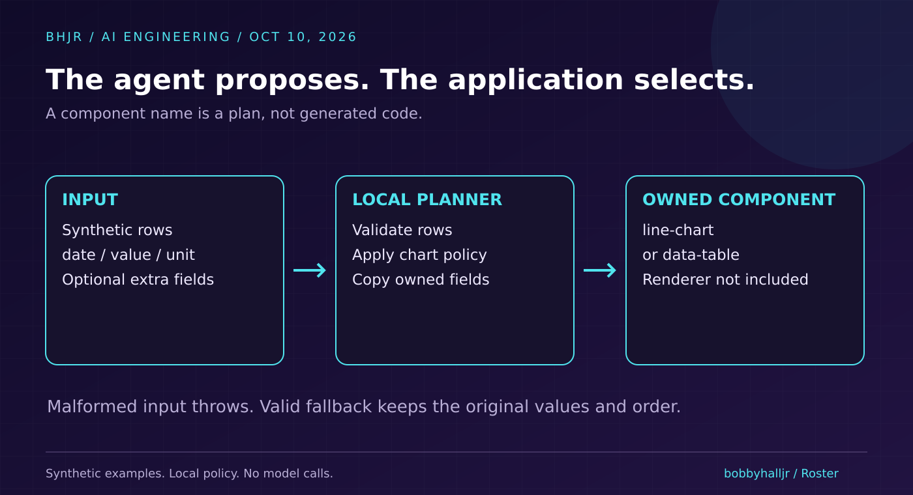
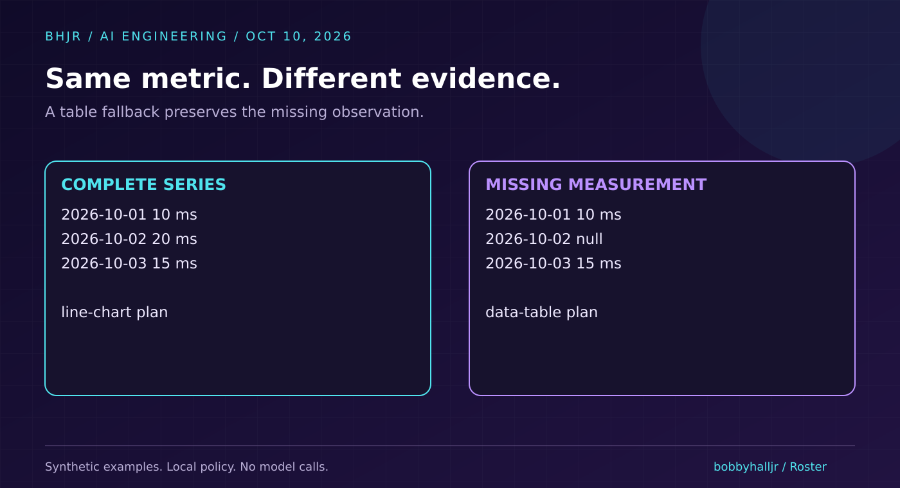
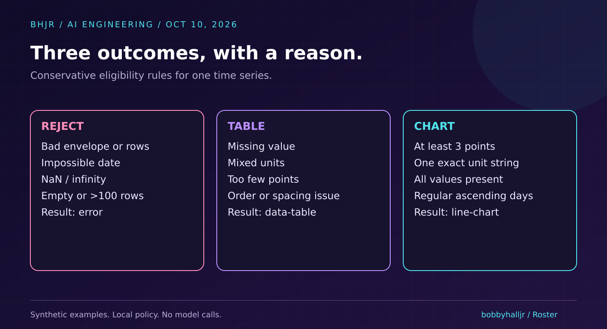

# Your Agent Picked a Chart. Did the Data Deserve One? Build a UI Planner in TypeScript.

On **October 9, 2026**, CopilotKit [released Open Intelligent UI](https://www.copilotkit.ai/blog/introducing-open-intelligent-ui): an open-source chat interface that can answer with text, native components, or generated interactive UI.

The interesting engineering decision happens before the pixels. Which representation does the answer deserve?

The [project README](https://github.com/CopilotKit/OpenIntelligentUI) says its Jev router selects the presentation. Basic tables use A2UI; charts and more complex visuals use Open Generative UI. Its default setup requires an OpenAI key and a TypeSafe key. I verified the announcement and README, but did not run that full application.

I want to build a smaller piece of that problem today: a deterministic boundary between a proposed visualization and the component our application will actually use.

**A missing measurement should stay missing. A prettier answer should not quietly invent a trend.**



## A chart can make the wrong promise

Imagine an agent summarizing three days of latency:

| Date | Value | Unit |
| --- | ---: | --- |
| 2026-10-01 | 10 | ms |
| 2026-10-02 | unknown | ms |
| 2026-10-03 | 15 | ms |

These numbers are synthetic fixtures, not product measurements.

Replace the unknown with zero and you have changed the data. Connect the known points without explaining the gap and the UI can suggest continuity you did not observe.

A chart renderer *can* represent gaps correctly. This tiny planner deliberately chooses a table instead. That is a conservative product policy, not a universal visualization rule.

The goal is to make the representation decision explicit, reviewable, and testable.

## Give the application a component registry

Our registry contains two names:

- `line-chart` for complete, regularly spaced time series.
- `data-table` when valid rows need a more literal presentation.

The agent does not supply executable HTML. It supplies data. The application chooses an owned component and passes clean rows to it.

This example returns a plan. It does not implement the React components or draw the chart.



The rules are intentionally narrow. A chart requires at least three rows, one exact unit string, finite numeric values, strictly increasing dates, and equal spacing. Valid data that fails one of those chart rules becomes a table. Malformed input throws an error instead of entering either component.

Negative values and zero are valid numbers. `null` is missing. Those are different states.

## Build the planner

The complete source and 18 checks are in [the public repository](https://github.com/bobbyhalljr/generative-ui-planner).

Here is the central decision, after runtime validation has established that every row has a real calendar date, a nonempty unit, and a finite number or `null`:

```ts
const table = (reason: string): View => ({
  component: "data-table", reason, rows: clean
});

if (clean.length < 3) return table("too-few-points");
if (new Set(clean.map(r => r.unit)).size !== 1)
  return table("mixed-units");
if (clean.some(r => r.value === null))
  return table("missing-values");

const times = clean.map(r => Date.parse(r.date));
if (times.some((time, i) => i > 0 && time <= times[i - 1]))
  return table("not-strictly-chronological");

const step = times[1] - times[0];
if (times.some((time, i) => i > 1 && time - times[i - 1] !== step))
  return table("irregular-spacing");

return {
  component: "line-chart",
  reason: "complete-regular-series",
  rows: clean
};
```

Notice what this code does not do. It does not fill gaps, reorder observations, convert units, or smooth values. It retains the supplied order and values.

That makes the fallback explainable. The frontend can show: “Displaying a table because one measurement is missing.”

The full function accepts `unknown`, checks the envelope and every row, limits the input to 100 rows, and copies only `date`, `value`, and `unit`. An extra `html` field does not become a render instruction.

Copying selected fields reduces what crosses this boundary. It does not make arbitrary strings safe to inject into HTML. Renderers still need ordinary escaping.



## Run it without an API key

Prerequisite: **Node.js 22.20 or later**. Node's type stripping runs these TypeScript files without a dependency install or compilation step. It does not type-check them.

```bash
git clone https://github.com/bobbyhalljr/generative-ui-planner.git
cd generative-ui-planner
node --experimental-strip-types test.ts
```

The final three lines from the tested run:

```text
18/18 checks passed
complete: line-chart (complete-regular-series)
missing: data-table (missing-values)
```

The checks cover zero, negative values, missing values, mixed units, duplicate and descending dates, irregular spacing, impossible calendar dates, NaN, infinity, empty and oversized input, malformed envelopes, blank units, excluded extra markup, and preserving the original input.

These are deterministic checks of this local policy. They are not a benchmark of model accuracy, CopilotKit routing, or generated UI quality.

## Where this stops

This is a small planner for one time series. It does not decide whether a metric is trustworthy, whether its source is fresh, or whether connecting points is causally meaningful. Equal spacing is a chosen eligibility rule, not evidence of statistical validity.

It also does not provide an iframe sandbox, a CSP, an authorization system, or a safe interpreter for generated code. CopilotKit's announcement describes isolated iframe execution and an approved CDN list for its open UI path. I have not audited those controls.

In a production UI, I would add accessible components, visible units, provenance, chart gap semantics, honest axes, and a reason users can inspect when the application changes the suggested presentation.

The engineering takeaway is small: **let the agent propose the experience, and let the application own the rules for representing its data.**

That is the kind of boundary I care about while building Roster: AI employees that do real work, with outputs people can inspect and use.

## Primary references

- [CopilotKit launch announcement, October 9, 2026](https://www.copilotkit.ai/blog/introducing-open-intelligent-ui)
- [Open Intelligent UI source and setup requirements](https://github.com/CopilotKit/OpenIntelligentUI)
- [Node.js TypeScript documentation](https://nodejs.org/api/typescript.html)
